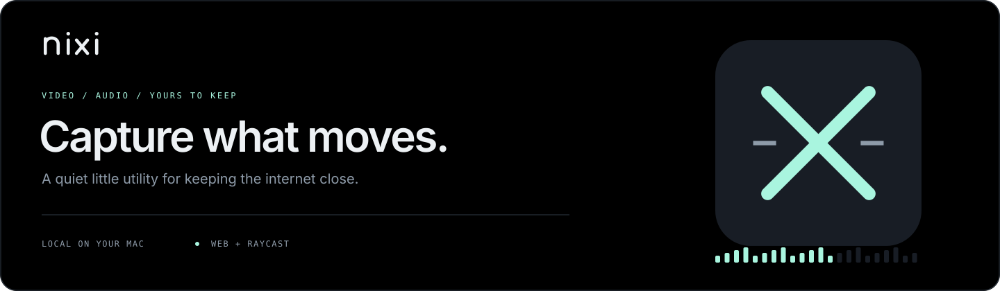
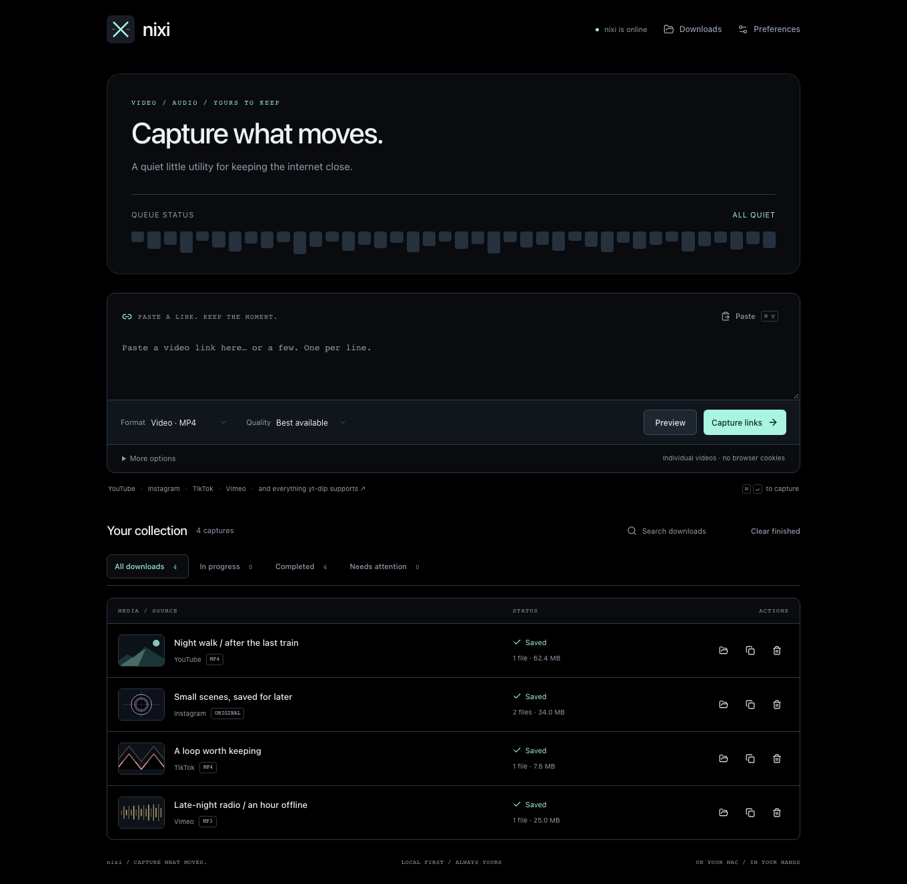
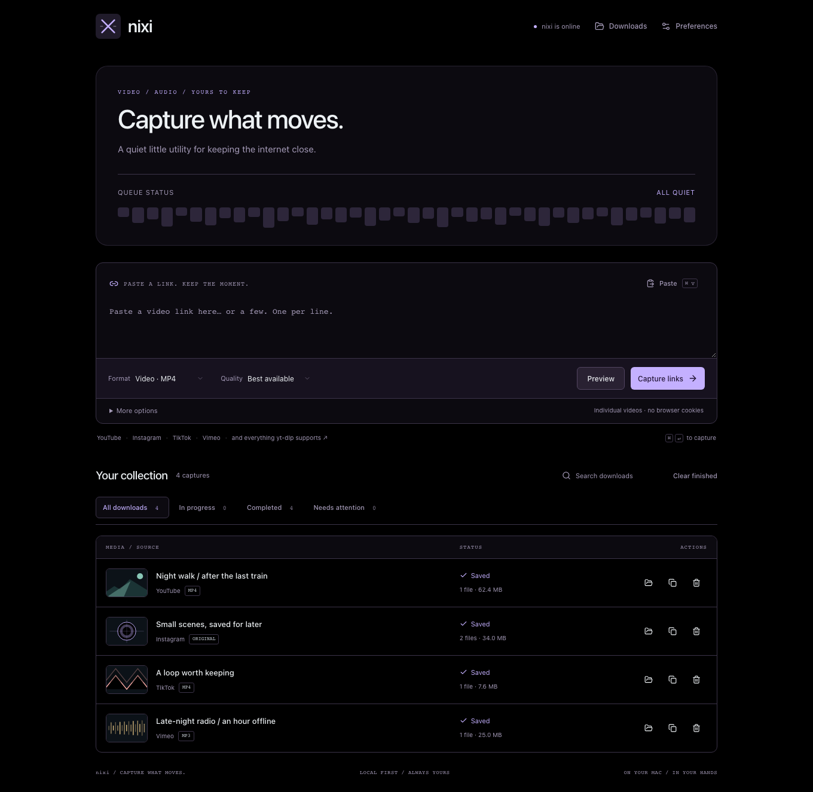
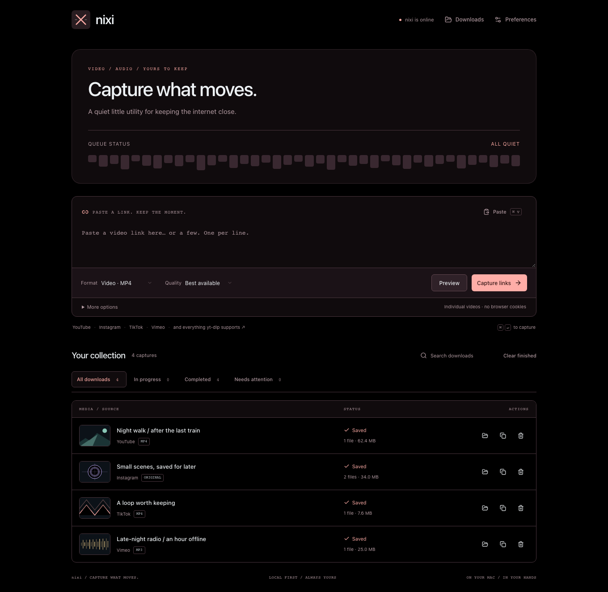
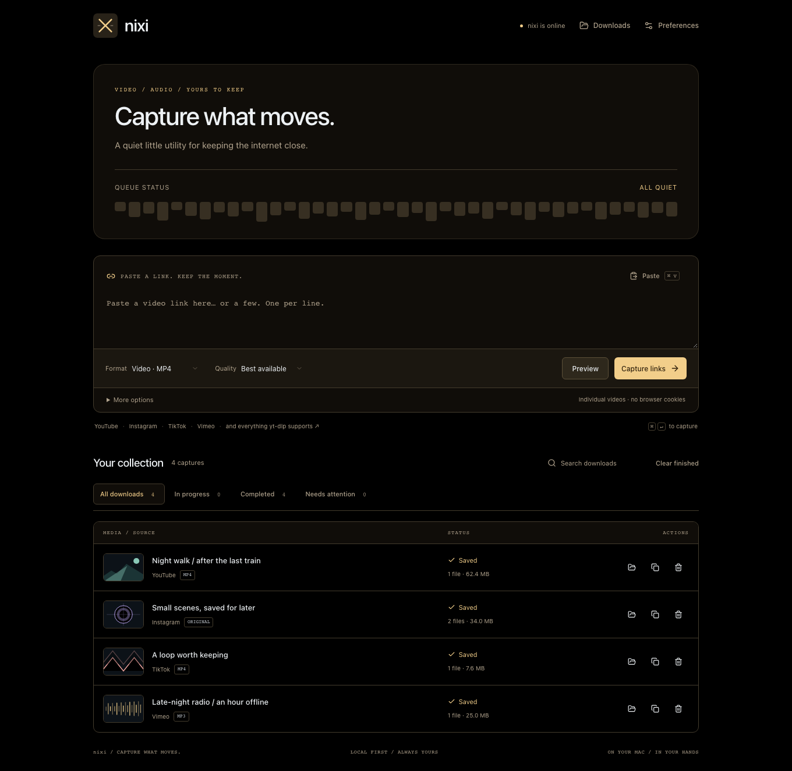
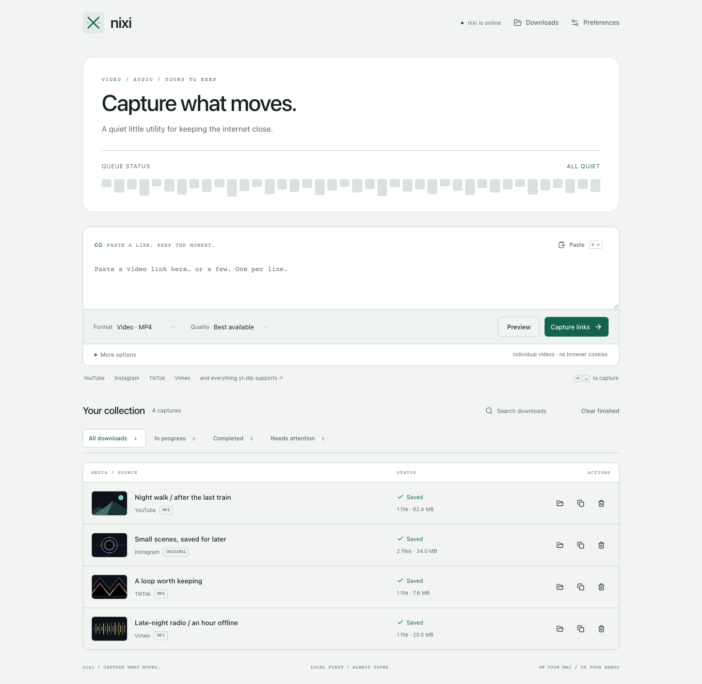
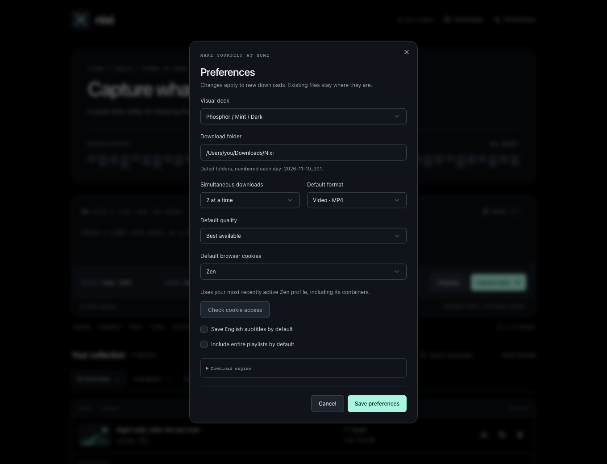
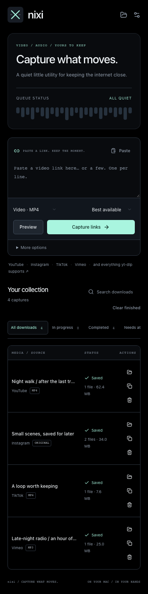

<p align="center">
  
</p>

<p align="center">
  A local video and audio collector for your Mac.<br />
  Paste a link in the web panel, or send it from Raycast. Nixi takes it from there.
</p>

<p align="center">
  <a href="#get-started">Get started</a> ·
  <a href="#from-raycast">Raycast</a> ·
  <a href="#pick-your-deck">Themes</a> ·
  <a href="#made-to-play-on-your-mac">Formats</a> ·
  <a href="docs/DEVELOPMENT.md">Development</a>
</p>



_Phosphor, the default deck. Screenshots show the real interface with an isolated sample collection._

## Keep something worth coming back to

- **One link or a whole haul.** Capture individual videos, batches, playlists and multi-video posts. YouTube, Instagram, TikTok, Vimeo and other [yt-dlp-supported sites](https://github.com/yt-dlp/yt-dlp/blob/master/supportedsites.md) share one queue.
- **Video, audio, yours to keep.** Save a QuickTime-compatible MP4, keep the original, or extract MP3, M4A, Opus, FLAC or WAV audio. Choose a video resolution from 480p through 4K, or the best available.
- **Two ways in. One collection.** The web panel and Raycast use the same background service, preferences, download queue and history. Downloads continue after you close either interface.
- **A place for every capture.** Folders use the local date and a daily index: `2026-11-10_001`, `2026-11-10_002`, and so on. Find a saved file, reveal it in Finder, or retry an interrupted download.
- **Bring your browser session.** Choose signed-in browser cookies when a site needs them, including Zen and Safari. Check access before capturing.

## Get started

You’ll need **macOS**, [mise](https://mise.jdx.dev/getting-started.html), and [Raycast](https://www.raycast.com/) if you want the keyboard workflow. Node, pnpm, yt-dlp, ffmpeg and the asset tools are declared in [`mise.toml`](mise.toml).

```sh
git clone git@github.com:mesterM12/nixi.git
cd nixi
mise trust
mise install
mise exec -- pnpm install --frozen-lockfile
mise exec -- pnpm run install:agent
```

Open **[127.0.0.1:43174](http://127.0.0.1:43174)**. Nixi starts at login and saves new captures in `~/Downloads/Nixi/` unless you choose another folder in Preferences. Keep the checkout in place while the service is installed.

**Your first capture:** paste a link, choose a format, then **Capture links**. Add several links at once for a batch; **More options** holds playlists, browser cookies and English subtitles. **Preview** reads one link before you commit it to the queue.

| In the web panel          | Shortcut  |
| ------------------------- | --------- |
| Focus the links field     | `⌘ K`     |
| Capture the entered links | `⌘ Enter` |

These are web-panel shortcuts. Raycast aliases and hotkeys are configured separately.

## From Raycast

From the project folder, import the local extension:

```sh
mise exec -- pnpm --dir raycast run dev
```

Once imported, the built commands remain available after you stop the development watcher.

| Command                 | What it does                                                                              | Search keyword |
| ----------------------- | ----------------------------------------------------------------------------------------- | -------------- |
| **Nixi: Capture**       | Type a link or start with your clipboard. Choose video, audio, batch or playlist options. | `nx`           |
| **Nixi: Quick Capture** | Queue clipboard links immediately with your saved defaults.                               | `nq`           |
| **Nixi: Extract Audio** | Go straight to audio capture from a link or the clipboard.                                | `na`           |
| **Nixi: Queue**         | Browse active captures and history, retry failures, and reveal saved files.               | `nqueue`       |
| **Nixi: Open Panel**    | Open the full web interface.                                                              | `nixi`         |

Capture a link and get back to what you were doing. Batch capture and playlists live inside **Capture**; history lives inside **Queue**. The keywords above are search terms, not assigned hotkeys. Set personal aliases and hotkeys in **Raycast Settings → Extensions**.

## Pick your deck

Pure-black canvases, soft signal colors and a little room to breathe. Switch decks in **Preferences → Visual deck**. Your choice is remembered in this browser; the logo, favicon, artwork and controls follow it.

**Phosphor** is the mint default shown above. Four more decks change the mood:

<table>
  <tr>
    <td width="50%"><br /><strong>Ultraviolet</strong> · Orchid after dark</td>
    <td width="50%"><br /><strong>Infrared</strong> · A warmer signal</td>
  </tr>
  <tr>
    <td width="50%"><br /><strong>Amber</strong> · Late-night gold</td>
    <td width="50%"><br /><strong>Daylight</strong> · Jade in the light</td>
  </tr>
</table>

Raycast keeps its native interface colors and Nixi’s Phosphor icon. See the [identity and design notes](DESIGN.md) for the palette and original vector assets.

<details>
<summary>Preferences, up close</summary>



</details>

<details>
<summary>The panel on a smaller screen</summary>



</details>

## Made to play on your Mac

| Output                            | What you get                                                                                                                                                                        |
| --------------------------------- | ----------------------------------------------------------------------------------------------------------------------------------------------------------------------------------- |
| **Video · MP4**                   | H.264 video and AAC audio for native Mac playback. Compatible streams avoid recompression; other streams are converted before the capture is marked saved.                          |
| **Video · Original**              | The source file stays untouched. Nixi adds a playable `.mac.mp4` companion when its container, codecs or requested resolution need conversion. Open that companion in QuickTime.    |
| **MP3 / M4A / Opus / FLAC / WAV** | Audio extracted from the source. M4A, MP3 and WAV offer wider compatibility across macOS versions; Opus and FLAC were also verified with the native decoder on the development Mac. |

Video limits are **480p, 720p, 1080p, 1440p and 4K**, plus **Best available**. If a source has no lower-resolution stream, Nixi can resize the playable MP4. It keeps an Original source intact alongside any resized companion. Converting lossy audio to FLAC or WAV preserves the available sound; it cannot restore lost detail.

The automated format matrix checks real downloads and full decoding, including Apple’s native media framework on macOS. Playwright repeats the format cases through desktop and mobile layouts. See [testing and verification](docs/DEVELOPMENT.md#testing).

## A little help, when you need it

**Safari says “Operation not permitted”?** Use **Check cookie access** and follow its Full Disk Access guidance. **Zen user?** Pick Zen directly; Nixi uses its own Firefox-compatible profile. [Browser-cookie help →](docs/TROUBLESHOOTING.md#browser-cookies)

**An original won’t open in QuickTime?** Open its `.mac.mp4` companion, or choose **Video · MP4** for the next capture. [Playback and download help →](docs/TROUBLESHOOTING.md)

Site support follows the installed yt-dlp version. Some links need a valid login or have site, region or DRM restrictions. Updating yt-dlp can resolve extractor changes.

## Under the hood

**React + Next.js + shadcn/ui** for the panel. **Node + SQLite** for one local service. **yt-dlp + ffmpeg** for capture. **Effect 4** scopes preview execution and cleanup. All media stays in your chosen download folder; the service listens on the Mac’s loopback address.

- [Development, architecture and tests](docs/DEVELOPMENT.md)
- [Troubleshooting, browser access and local data](docs/TROUBLESHOOTING.md)
- [Brand, themes and generated assets](DESIGN.md)
- [Reproduce these screenshots](docs/assets/README.md)

## Credits & license

Built on [yt-dlp](https://github.com/yt-dlp/yt-dlp) and [FFmpeg](https://ffmpeg.org/), with ideas from [ReClip](https://github.com/averygan/reclip) and Raycast’s [Video Downloader](https://github.com/raycast/extensions/tree/main/extensions/video-downloader). Nixi’s source and visual assets are independently implemented.

[MIT](LICENSE) · Capture what moves.
